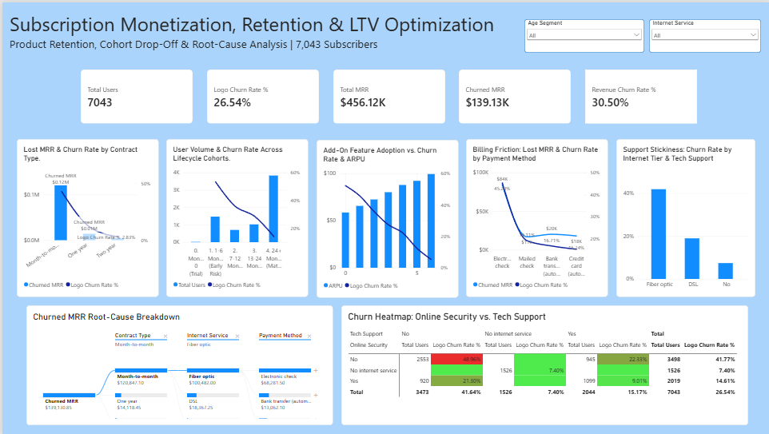
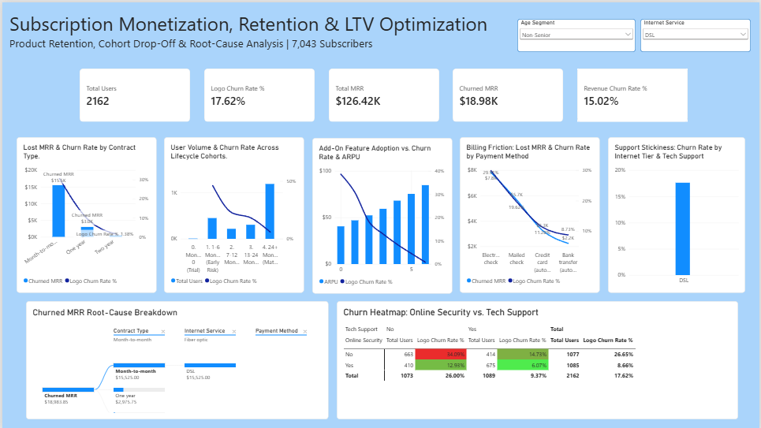

# Subscription Monetization, Retention & LTV Optimization (Power BI & SQL)

An end-to-end product monetization and retention analytics dashboard engineered in Power BI and SQL Server to diagnose logo vs. revenue churn, isolate high-risk user cohorts, measure add-on feature stickiness, and guide targeted retention interventions.

## 📊 Live Dashboard & Interactive Drill-Down

### Executive Population Overview

Displays subscription-wide metrics across **7,043 subscribers** totaling **\$456.12K** in Monthly Recurring Revenue (MRR), a **26.54%** logo churn rate, and a **30.50%** revenue churn rate (**\$139.13K** in lost MRR).


### Segment & Root-Cause Drill-Down

Dynamic slicing by `age_segment` and `internet_service`, alongside interactive Decomposition Tree root-cause pathing (`Month-to-Month` $\rightarrow$ `Fiber Optic` $\rightarrow$ `Electronic Check` = **\$68,281.50** in lost MRR, accounting for **49%** of all revenue churn).


## 🎯 Project Objectives & Product Use Cases

* **Logo vs. Revenue Churn Diagnostics:** Uncover why monthly revenue churn (**30.50%**) outpaces user churn (**26.54%**) by comparing ARPU across churned (**\$74.44**) vs. retained (**\$61.27**) cohorts.

* **Lifecycle Cohort Drop-Off Tracking:** Pinpoint critical early-lifecycle churn spikes (**53.33%** churn during Months 1–6) to prioritize onboarding and activation workflows.

* **Billing & Payment Friction Analysis:** Quantify how manual payment methods (**Electronic Check** at **45.29%** churn) compare against automated billing (**Credit Card / Bank Transfer** at **15.24%–16.71%** churn).

* **Product Stickiness & Bundling Lift:** Evaluate how utility add-on adoption (`Online Security`, `Tech Support`, `Online Backup`, `Device Protection`) reduces churn from **52.24%** (0 add-ons) down to **5.28%** (6 add-ons) while expanding ARPU.

## 🏗️ Data Architecture & Model

The reporting model connects Power BI directly to a cleaned SQL Server analytical view (`vw_telco_clean`) paired with a dedicated, disconnected KPI measure table (`_Key_Measures`) for fast DAX evaluation:

### Tables & Structure

* **`vw_telco_clean`**: Cleaned SQL Server view containing **7,043** subscriber records (`customer_id`, `gender`, `age_segment`, `has_partner`, `has_dependents`, `tenure_months`, `tenure_cohort`, `phone_service`, `multiple_lines`, `internet_service`, `online_security`, `online_backup`, `device_protection`, `tech_support`, `streaming_tv`, `streaming_movies`, `active_addons_count`, `contract_type`, `paperless_billing`, `payment_method`, `monthly_charges`, `total_charges`, `churn_status`, `is_churned`).

* **`_Key_Measures`**: Dedicated disconnected container housing centralized DAX business logic for volume, recurring revenue, churn rates, LTV, and risk exposure.

## 🛠️ Data Pipeline & SQL Transformations

All schema hygiene, null-handling, cohort bucketing, and root-cause rankings were engineered in **SQL Server Management Studio (SSMS)** prior to Power BI ingestion[cite: 5]. Stored in [`sql/Telco_customer.sql`](sql/Telco_customer.sql):
```sql
/* ============================================================================
   PROJECT: Subscription Monetization, Retention & LTV Optimization (SQL Server)
   SOURCE TABLE: [dbo].[Telco_Customer$]
   ============================================================================ */

-- ----------------------------------------------------------------------------
-- STEP 1: DATA CLEANING & FEATURE ENGINEERING VIEW
-- Run this section first (or run the whole script; GO separates the batches)
-- ----------------------------------------------------------------------------
IF OBJECT_ID('[dbo].[vw_telco_clean]', 'V') IS NOT NULL
    DROP VIEW [dbo].[vw_telco_clean];
GO

CREATE VIEW [dbo].[vw_telco_clean] AS
SELECT 
    [customerID] AS customer_id,
    [gender],
    CASE WHEN [SeniorCitizen] = 1 THEN 'Senior' ELSE 'Non-Senior' END AS age_segment,
    [Partner] AS has_partner,
    [Dependents] AS has_dependents,
    CAST([tenure] AS INT) AS tenure_months,
    CASE 
        WHEN [tenure] = 0 THEN '0. Month 0 (Trial)'
        WHEN [tenure] BETWEEN 1 AND 6 THEN '1. 1-6 Months (Early Risk)'
        WHEN [tenure] BETWEEN 7 AND 12 THEN '2. 7-12 Months'
        WHEN [tenure] BETWEEN 13 AND 24 THEN '3. 13-24 Months'
        ELSE '4. 24+ Months (Mature)'
    END AS tenure_cohort,
    [PhoneService] AS phone_service,
    [MultipleLines] AS multiple_lines,
    [InternetService] AS internet_service,
    [OnlineSecurity] AS online_security,
    [OnlineBackup] AS online_backup,
    [DeviceProtection] AS device_protection,
    [TechSupport] AS tech_support,
    [StreamingTV] AS streaming_tv,
    [StreamingMovies] AS streaming_movies,
    -- Feature Adoption Score (0 to 6 add-ons)
    (CASE WHEN [OnlineSecurity] = 'Yes' THEN 1 ELSE 0 END +
     CASE WHEN [OnlineBackup] = 'Yes' THEN 1 ELSE 0 END +
     CASE WHEN [DeviceProtection] = 'Yes' THEN 1 ELSE 0 END +
     CASE WHEN [TechSupport] = 'Yes' THEN 1 ELSE 0 END +
     CASE WHEN [StreamingTV] = 'Yes' THEN 1 ELSE 0 END +
     CASE WHEN [StreamingMovies] = 'Yes' THEN 1 ELSE 0 END) AS active_addons_count,
    [Contract] AS contract_type,
    [PaperlessBilling] AS paperless_billing,
    [PaymentMethod] AS payment_method,
    CAST([MonthlyCharges] AS DECIMAL(10,2)) AS monthly_charges,
    -- Safely handles NULLs and blank strings in Excel imports using TRY_CAST
    COALESCE(TRY_CAST(NULLIF(LTRIM(RTRIM(CAST([TotalCharges] AS VARCHAR(50)))), '') AS DECIMAL(10,2)), 0.00) AS total_charges,
    [Churn] AS churn_status,
    CASE WHEN [Churn] = 'Yes' THEN 1 ELSE 0 END AS is_churned
FROM [dbo].[Telco_Customer$];
GO


-- ----------------------------------------------------------------------------
-- QUERY 1: EXECUTIVE KPI BASELINE (LOGO CHURN VS. MRR REVENUE CHURN)
-- ----------------------------------------------------------------------------
SELECT 
    COUNT(customer_id) AS total_users,
    SUM(is_churned) AS churned_users,
    CAST(ROUND(100.0 * SUM(is_churned) / COUNT(customer_id), 2) AS DECIMAL(5,2)) AS logo_churn_rate_pct,
    CAST(ROUND(SUM(monthly_charges), 2) AS DECIMAL(12,2)) AS total_mrr,
    CAST(ROUND(SUM(CASE WHEN is_churned = 1 THEN monthly_charges ELSE 0 END), 2) AS DECIMAL(12,2)) AS churned_mrr,
    CAST(ROUND(100.0 * SUM(CASE WHEN is_churned = 1 THEN monthly_charges ELSE 0 END) / SUM(monthly_charges), 2) AS DECIMAL(5,2)) AS mrr_churn_rate_pct,
    CAST(ROUND(AVG(CASE WHEN is_churned = 1 THEN monthly_charges END), 2) AS DECIMAL(10,2)) AS avg_arpu_churned,
    CAST(ROUND(AVG(CASE WHEN is_churned = 0 THEN monthly_charges END), 2) AS DECIMAL(10,2)) AS avg_arpu_retained
FROM [dbo].[vw_telco_clean];


-- ----------------------------------------------------------------------------
-- QUERY 2: TENURE COHORT SURVIVAL & CUMULATIVE LOST MRR (WINDOW FUNCTIONS)
-- ----------------------------------------------------------------------------
WITH cohort_summary AS (
    SELECT 
        tenure_cohort,
        COUNT(customer_id) AS users_in_cohort,
        SUM(is_churned) AS churned_users,
        SUM(monthly_charges) AS cohort_mrr,
        SUM(CASE WHEN is_churned = 1 THEN monthly_charges ELSE 0 END) AS lost_mrr
    FROM [dbo].[vw_telco_clean]
    GROUP BY tenure_cohort
),
cohort_shares AS (
    SELECT 
        tenure_cohort,
        users_in_cohort,
        churned_users,
        CAST(ROUND(100.0 * churned_users / users_in_cohort, 2) AS DECIMAL(5,2)) AS cohort_churn_pct,
        CAST(ROUND(lost_mrr, 2) AS DECIMAL(12,2)) AS lost_mrr,
        100.0 * lost_mrr / SUM(lost_mrr) OVER () AS pct_share
    FROM cohort_summary
)
SELECT 
    tenure_cohort,
    users_in_cohort,
    churned_users,
    cohort_churn_pct,
    lost_mrr,
    CAST(ROUND(pct_share, 2) AS DECIMAL(5,2)) AS pct_of_total_lost_mrr,
    CAST(ROUND(SUM(pct_share) OVER (ORDER BY tenure_cohort), 2) AS DECIMAL(5,2)) AS cumulative_lost_mrr_pct
FROM cohort_shares
ORDER BY tenure_cohort;


-- ----------------------------------------------------------------------------
-- QUERY 3: ROOT-CAUSE ANALYSIS (RCA) — TOP 10 REVENUE LOSS SEGMENTS
-- ----------------------------------------------------------------------------
WITH segment_metrics AS (
    SELECT 
        contract_type,
        internet_service,
        payment_method,
        COUNT(*) AS segment_users,
        SUM(is_churned) AS churned_users,
        CAST(ROUND(100.0 * SUM(is_churned) / COUNT(*), 2) AS DECIMAL(5,2)) AS churn_rate_pct,
        CAST(ROUND(SUM(CASE WHEN is_churned = 1 THEN monthly_charges ELSE 0 END), 2) AS DECIMAL(12,2)) AS at_risk_mrr
    FROM [dbo].[vw_telco_clean]
    GROUP BY contract_type, internet_service, payment_method
    HAVING COUNT(*) >= 50
)
SELECT TOP 10
    contract_type,
    internet_service,
    payment_method,
    segment_users,
    churned_users,
    churn_rate_pct,
    at_risk_mrr,
    DENSE_RANK() OVER (ORDER BY at_risk_mrr DESC) AS revenue_loss_rank
FROM segment_metrics
ORDER BY revenue_loss_rank;


-- ----------------------------------------------------------------------------
-- QUERY 4: PRODUCT STICKINESS — ADD-ON ADOPTION VS. CHURN & ARPU LIFT
-- ----------------------------------------------------------------------------
SELECT 
    active_addons_count,
    COUNT(*) AS total_users,
    CAST(ROUND(AVG(monthly_charges), 2) AS DECIMAL(10,2)) AS avg_arpu,
    CAST(ROUND(100.0 * SUM(is_churned) / COUNT(*), 2) AS DECIMAL(5,2)) AS churn_rate_pct,
    CAST(ROUND(AVG(CAST(tenure_months AS FLOAT)), 1) AS DECIMAL(5,1)) AS avg_tenure_months
FROM [dbo].[vw_telco_clean]
WHERE internet_service <> 'No'
GROUP BY active_addons_count
ORDER BY active_addons_count;


-- ----------------------------------------------------------------------------
-- QUERY 5: ACTIONABLE RETENTION TARGET LIST (HIGH-RISK ACTIVE USERS)
-- ----------------------------------------------------------------------------
SELECT TOP 25
    customer_id,
    tenure_months,
    contract_type,
    internet_service,
    payment_method,
    active_addons_count,
    monthly_charges,
    total_charges
FROM [dbo].[vw_telco_clean]
WHERE is_churned = 0
  AND contract_type = 'Month-to-month'
  AND internet_service = 'Fiber optic'
  AND payment_method = 'Electronic check'
  AND active_addons_count = 0
ORDER BY monthly_charges DESC;
```

## 🧮 Core DAX Measures

Centralized inside [`dax/all_measures.dax`](dax/all_measures.dax):

### 1. User Volume & Retention Aggregations

```dax
Total Users = COUNTROWS('vw_telco_clean')

Active Users = CALCULATE([Total Users], 'vw_telco_clean'[is_churned] = 0)

Churned Users = CALCULATE([Total Users], 'vw_telco_clean'[is_churned] = 1)
```

### 2. Recurring Revenue & Monetization KPIs

```dax
Total MRR = SUM('vw_telco_clean'[monthly_charges])

Churned MRR = CALCULATE([Total MRR], 'vw_telco_clean'[is_churned] = 1)

ARPU = AVERAGE('vw_telco_clean'[monthly_charges])
```

### 3. Churn Rates, Customer LTV & Risk Exposure

```dax
Logo Churn Rate % = DIVIDE([Churned Users], [Total Users], 0)

Revenue Churn Rate % = DIVIDE([Churned MRR], [Total MRR], 0)

Estimated Customer LTV = DIVIDE([ARPU], [Logo Churn Rate %], 0)

At-Risk Active MRR = 
CALCULATE(
    [Total MRR], 
    'vw_telco_clean'[is_churned] = 0, 
    'vw_telco_clean'[contract_type] = "Month-to-month", 
    'vw_telco_clean'[internet_service] = "Fiber optic"
)
```

## 🎨 UI/UX & Dashboard Design Standards

* **Theme & Canvas Architecture:** Built on Power BI's **Fluent 2 (`Fluent2-CY26SU10`)** base theme featuring a cool sky-blue canvas (`#93C5FD` / `#A5D8FF`) with floating pure white (`#FFFFFF`) card containers, rounded corners (`8px`), and subtle drop shadows for clean visual separation.
* **Three-Tier Executive Information Hierarchy:**
  * **Top Tier (Header & KPI Strip):** White banner typography paired with global dropdown slicers (`age_segment`, `internet_service`) and 5 New Card KPI tiles (`Total Users`, `Logo Churn Rate %`, `Total MRR`, `Churned MRR`, `Revenue Churn Rate %`).
  * **Middle Tier (5-Column Driver & Trend Row):** Equal-width analytical cards combining dual-axis Line & Clustered Column charts (`Contract Type`, `Lifecycle Cohorts`, `Add-On Feature Adoption`), a dual-axis Line chart (`Billing Friction`), and a Clustered Column comparison (`Support Stickiness`).
  * **Bottom Tier (Root-Cause & Matrix Deep-Dive):** Asymmetric 2-panel split pairing an interactive **Decomposition Tree** (`Churned MRR Root-Cause Breakdown`) on the left with a **Conditional Heatmap Matrix** (`Online Security vs. Tech Support`) on the right.
* **Semantic Color Encoding:**
  * **Primary Volume, Revenue & ARPU Bars:** Vibrant Fluent Blue (`#0078D4` / `#0284C7`)
  * **Churn Rate Trend Lines & Tree Paths:** Deep Indigo / Navy (`#1E3A8A` / `#0F172A`)
  * **Heatmap Risk Gradient:** Red (`#EF4444`) for peak churn (`49%`) transitioning through Olive Amber (`#84CC16`) to Green (`#22C55E`) for low-churn retained segments (`7%–9%`)
* **Typography & Scannability:** Clean Segoe UI hierarchy with dark charcoal KPI callouts (`#1E293B`), concise single-line visual headers, and muted axis labels (`#64748B`) to maximize data-ink ratio.

## 📂 Repository Directory Structure

```text
├── assets/
│   ├── Dashboard_Overview.png              # Full executive dashboard screenshot
│   ├── Segment_Drilldown.png                # Filtered root-cause view screenshot
│                                            # Power BI data model diagram
├── data/
│   └── Telco_Customer.xlsx                  # Raw subscription dataset (7,043 records)
├── dax/
│   └── all_measures.dax                     # Consolidated DAX calculation script
├── sql/
│   └── Telco_customer.sql         # SQL view and analytical queries
├── Telco_customer_Dashboard.pbix            # Complete Power BI report and data model
└── README.md
```

## 🚀 Getting Started & Replication

1. **Clone the Repository:**
   ```bash
   git clone https://github.com/<your-username>/subscription-retention-ltv-analytics.git
   ```
2. **Database Setup (SQL Server):**
   * Import `data/Telco_Customer.xlsx` into SQL Server as `[dbo].[Telco_Customer$]` and execute `sql/telco_retention_analysis.sql` to create `vw_telco_clean`.
3. **Open the Report:**
   * Launch `Telco_customer_Dashboard.pbix` in **Power BI Desktop** and update the SQL Server connection string under **Home > Transform Data > Data Source Settings** if prompted.
4. **Interact with the Dashboard:**
   * Use the top slicers (`age_segment` and `internet_service`), click nodes inside the **Churned MRR Root-Cause Breakdown** tree, or cross-filter by contract and tenure cohorts to explore retention dynamics.
